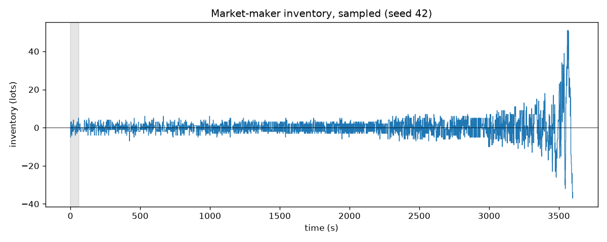
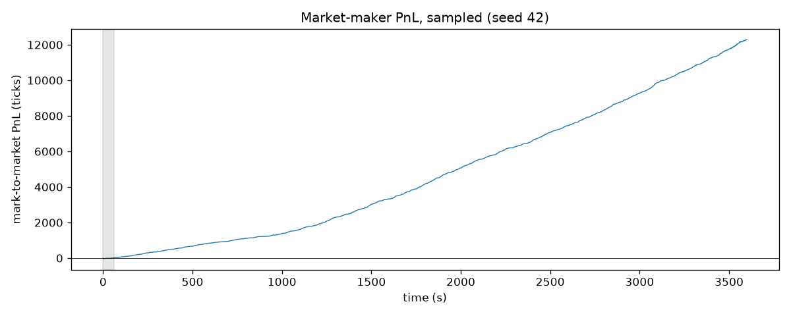
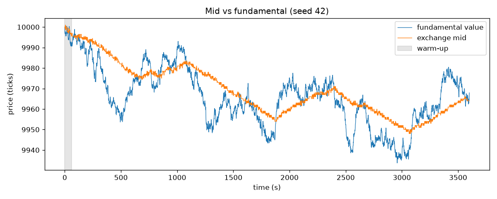
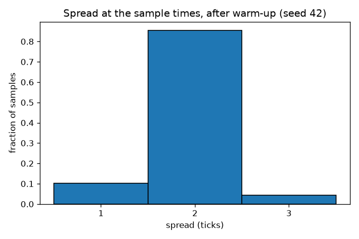
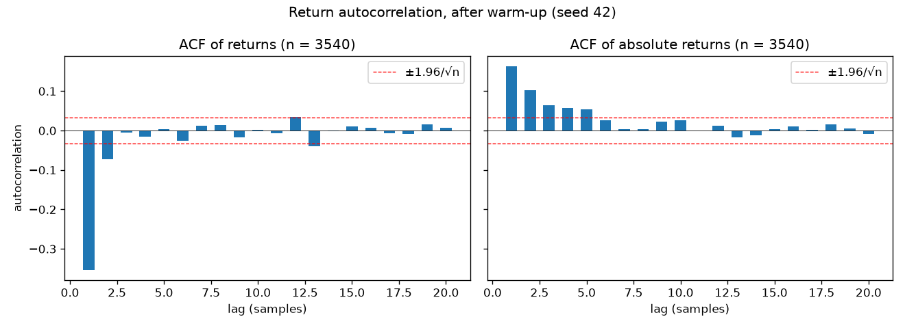

# lobsim

[](https://github.com/RyanHuangcodes/lobsim/actions/workflows/ci.yml)
[](https://ryanhuangcodes.github.io/lobsim/?run=demo)

A limit order book, matching engine and agent-based trading simulator in C++20, with a differential fuzzer that proves the fast engine matches a simple reference engine, a LOBSTER replayer for exchange data, and a browser dashboard that replays a simulated hour.

**Live dashboard:** [ryanhuangcodes.github.io/lobsim/?run=demo](https://ryanhuangcodes.github.io/lobsim/?run=demo) replays one simulated hour (default config, seed 42): order-book heatmap, depth ladder, price and fair value, and the market maker's inventory and PnL on one timeline.

## At a glance

| | |
|---|---|
| Throughput | ~47.5 million messages/s on one core (median of 3 runs: 45.4 to 49.2), Apple M4 |
| Latency | p99 26 ns per message, timed in batches of 32 (the clock steps in 41 ns, see [Benchmarks](#benchmarks)) |
| Versus the naive reference book | 31x faster, identical event hash |
| Correctness | Event-for-event differential testing and coverage-guided fuzzing against a reference engine; 99.4% line coverage of the matching engine |
| Injected-bug canaries | 3 deliberate matching bugs, each caught by the fuzzer in under 1 s (with or without seed inputs); CI fails if any stops being caught |
| Determinism | Same config and seed give byte-identical output; the order log replays to the same engine event hash |
| CI | GCC and Clang, Debug and Release, ASan + UBSan, fuzz smoke tests, canaries, coverage, nightly fuzzing, automatic dashboard deploy |

## What's in it

- **Matching engine** (`lob`): price-time priority, limit GTC/IOC/FOK, market and post-only orders, modify with explicit priority rules, and two self-trade-prevention modes. A fast `OrderBook` (`std::map` price levels, intrusive FIFO lists, a pooled order store, O(1) lookup by id) is checked event for event against a deliberately naive `ReferenceBook`.
- **Simulator** (`sim`): a deterministic discrete-event simulation with per-agent latency. Ten zero-intelligence noise traders, an informed trader who sees a latent fundamental value, and an Avellaneda–Stoikov market maker trade through the engine. Agents see the market only through delayed messages, and fills happen only through the engine, so queue position is real.
- **Outputs**: every trade, sampled top of book, every market-maker fill with markouts, a `summary.json` of all metrics, and the full request log, which replays to the same engine event hash.
- **Fuzzing and CI** ([FUZZING.md](FUZZING.md)): libFuzzer targets for the engine and both parsers, injected-bug canaries that CI requires the fuzzer to catch, and a nightly fuzz run.
- **LOBSTER replay** ([REAL_DATA.md](REAL_DATA.md)): `lobsim_lobster` rebuilds the book from a LOBSTER message file, compares it with the published book after every message, and checks lobsim's matching rule against every burst of executions. Tested on synthetic data so far; real Nasdaq results are pending.
- **Dress rehearsal**: two synthetic LOBSTER-like fake days (full opening book, hidden executions, a halt, price-window filtering) with an audit that explains every discrepancy, run in CI.
- **Calibration** ([CALIBRATION.md](CALIBRATION.md)): `lobsim_calibrate` measures the order flow (rates, placement, sizes, lifetimes) from a LOBSTER day, a calibrated background agent reproduces it in the simulator, and `validate` tests the result on a later period the estimator never reads. Rehearsed on synthetic days; real-data results are pending.
- **Replay dashboard** ([DASHBOARD.md](DASHBOARD.md)): `lobsim_viz_export` turns a run into a compact bundle after re-verifying its event hash and PnL, and a no-build static web app replays it. GitHub Actions rebuilds and deploys it to GitHub Pages on every push to `main`.

`SPEC.md` is the original specification and `DECISIONS.md` records every decision the specification left open, one line each with the reason.

### Milestones

| | Milestone | Status |
|---|---|---|
| 0 | Matching engine, simulator, benchmarks | Done |
| 1 | Coverage-guided differential fuzzing, injected-bug canaries, CI | Done |
| 2 | LOBSTER replayer and matching-agreement check | Done; real-data run pending data access |
| 2b | Dress rehearsal on synthetic LOBSTER-like days, with audit and CI test | Done |
| 4 | Replay dashboard, deployed to GitHub Pages | Done |
| 3a | Calibration: order flow measured from LOBSTER data, a calibrated background flow, out-of-sample validation ([CALIBRATION.md](CALIBRATION.md)) | Built and rehearsed on synthetic days; real-data run pending data |
| 3 | Calibration, and an informed trader that reacts to the size of the mispricing | Next |
| | Reinforcement-learning environment, binary market-data feed, multithreading | Planned |

## Contents

- [Build, test and run](#build-test-and-run)
- [Architecture](#architecture)
- [The matching engine](#the-matching-engine)
- [The simulator](#the-simulator)
- [Results of a sample run](#results-of-a-sample-run)
- [Benchmarks](#benchmarks)
- [Design decisions and trade-offs](#design-decisions-and-trade-offs)
- [Testing](#testing)
- [Continuous integration](#continuous-integration)
- [How correctness is verified](#how-correctness-is-verified)
- [Real-data replay (data pending)](#real-data-replay-data-pending)
- [Calibration (data pending)](#calibration-data-pending)
- [Live dashboard](#live-dashboard)
- [What is not modelled](#what-is-not-modelled)

## Build, test and run

Requirements: a C++20 compiler (the specification targets GCC 11+ and Clang 14+; the project is built and tested with Apple clang 17 on an arm64 Mac, and in CI on Linux with GCC 14 and Clang 18), CMake 3.21+ for the presets (3.20 works with plain `cmake -S . -B build -DCMAKE_BUILD_TYPE=Release`), and network access on the first configure: googletest v1.14.0, Google Benchmark v1.8.3 and nlohmann/json v3.11.3 are fetched at pinned tags. The plotting script needs Python 3 with pandas and matplotlib; the sweep script needs only the standard library.

```
cmake --preset release && cmake --build --preset release -j && ctest --preset release
cmake --preset debug    && cmake --build --preset debug -j    && ctest --preset debug
cmake --preset sanitize && cmake --build --preset sanitize -j && ctest --preset sanitize   # ASan + UBSan
```

The suite has more than 500 tests, with one extra pool test in the sanitize build that exists only under AddressSanitizer. All three builds compile with `-Wall -Wextra -Wpedantic -Werror` (`LOBSIM_WERROR`, on by default). The libFuzzer targets and the commands to build them (`-DLOBSIM_FUZZ=ON`, LLVM Clang only) are in [FUZZING.md](FUZZING.md). On an Apple M4 the sanitize suite takes about 100 seconds, most of it the differential fuzz test.

Run the default one-hour simulation, check its replay, and draw its plots:

```
./build/release/lobsim_run --config configs/default.json --out out/run1      # [--seed N] [--duration-s X]
./build/release/lobsim_replay --log out/run1/orders.log                      # prints the engine event hash
python tools/plot.py --run out/run1                                          # writes out/run1/plots/*.png
python tools/sweep.py --bin build/release/lobsim_run --config configs/default.json --out out/sweep
```

`lobsim_run` writes `orders.log`, `trades.csv`, `bbo.csv`, `mm_fills.csv` and `summary.json` and prints a summary. The hash printed by `lobsim_replay` equals `engine_event_hash` in `summary.json`. `tools/sweep.py` runs 89 one-hour simulations (about 30 seconds on an Apple M4) and prints the four multi-seed tables used in this README.

Export a run in LOBSTER format and replay it against its own book with the LOBSTER replayer (the same tool is meant for real LOBSTER files but has not been run on any; see [Real-data replay](#real-data-replay-data-pending)):

```
./build/release/lobsim_export_lobster --run out/run1 --levels 10 --out out/lobster1       # [--filter-window]
./build/release/lobsim_lobster --messages out/lobster1/SIM_2012-06-21_34200000_57600000_message_10.csv \
  --orderbook out/lobster1/SIM_2012-06-21_34200000_57600000_orderbook_10.csv --mode strict --compare-depth 10
```

## Architecture

```
  configs/default.json
          |
          v
  +-------------------------------- sim: single thread, discrete events -------------------------------+
  |                                                                                                      |
  |   EventQueue: min-heap on (time_ns, seq)          Fundamental V (random walk, every 0.1 s)           |
  |        |                                                 |                                           |
  |        v                                                 | read only by the informed trader          |
  |   Agents                                                 v                                           |
  |     NoiseTrader x 10      --- request --> entry latency ---------->  Exchange                        |
  |     InformedTrader                                                     |  appends every request      |
  |     AvellanedaStoikovMM                                                |  to orders.log              |
  |        ^      ^                                                        v                             |
  |        |      +--- Ack / Reject / Trade / Cancelled / Modified --  lob::OrderBook                    |
  |        |           (response latency, to the order's owner)            |                             |
  |        +---------- BBO / TradePrint (feed latency, to every agent) ----+                             |
  |                                                                                                      |
  |   Observers: zero latency, read-only. MetricsObserver -> trades.csv bbo.csv mm_fills.csv summary.json |
  +------------------------------------------------------------------------------------------------------+

  lobsim_replay: orders.log --> a fresh lob::OrderBook --> engine event hash (equal to the live run's)
```

`lob` does not depend on `sim`. Layout:

| Path | Contents |
|---|---|
| `include/lob`, `src/lob` | types and events, `ObjectPool`, `OrderBook`, `ReferenceBook`, `apply()` |
| `include/sim`, `src/sim` | RNG, event queue, latency channels, exchange, fundamental, config, kernel, metrics, replay, order-log codec |
| `include/sim/agents` | `NoiseTrader`, `InformedTrader`, `AvellanedaStoikovMM` |
| `apps` | `lobsim_run`, `lobsim_replay`, `lobsim_bench`, `lobsim_export_lobster`, `lobsim_lobster` |
| `bench` | Google Benchmark microbenchmarks |
| `tests` | unit tests, differential fuzz test, determinism and replay tests, simulator stress tests |
| `fuzz` | libFuzzer targets (engine differential, book builder, `orders.log` parser, LOBSTER parsers), seed corpora and saved regressions |
| `viz` | `lobsim_viz_export` and the bundle format ([viz/BUNDLE.md](viz/BUNDLE.md)) |
| `web` | the static replay dashboard (plain HTML, CSS and ES modules; vendored uPlot) |
| `scripts` | `run_real_data.sh`, `make_fake_day.sh`, `build_site.sh` and the dashboard test fixture |
| `.github/workflows` | `ci.yml`, `fuzz-nightly.yml`, `pages.yml` |
| `tools` | `plot.py`, `sweep.py`, `lobster_audit.py` (checks a replay of a synthetic LOBSTER-like export against the exporter's ground truth) |
| `docs/sample_run` | the plots of the sample run below |

## The matching engine

Prices are `int64` ticks and quantities `int64` lots. Decimals appear only for display.

**Matching.** An incoming order matches the best-priced resting order on the other side first and, within a price level, the earliest order first. Every trade prints at the resting (maker) order's price. A GTC remainder rests at the tail of its level; an IOC or market remainder is cancelled.

**Order types.**

| Type | Behaviour |
|---|---|
| Limit GTC | matches what crosses, rests the remainder |
| Limit IOC | matches what crosses, cancels the remainder (`IOCRemainder`) |
| Limit FOK | a read-only dry run in priority order counts fillable quantity; if it is short, `Ack` then `Cancelled(FOKUnfillable)` and nothing else changes |
| Market | IOC only; matches at any price; `Cancelled(NoLiquidity)` if nothing filled |
| Post-only | GTC only; rejected with `PostOnlyWouldCross` if its price reaches the opposite best |

**Validation** runs before any state change and the first failing check wins, so both books report the same reason. A rejected request changes nothing and consumes no order id. The order of checks is `InvalidQty`, `InvalidFlags`, `InvalidPrice`, `PostOnlyWouldCross` for new orders, and `UnknownOrder`, `NotOwner`, `InvalidQty`, `InvalidPrice`, `NoChange`, `PostOnlyWouldCross` for modifies.

**Modify.** Same price with a smaller quantity reduces the order in place and keeps its queue position. Any price change or quantity increase removes the order and re-enters it as a new arrival with the same id, which may trade as a taker. `Modified` is emitted before any trade it causes. `new_qty` is the new remaining quantity.

**Self-trade prevention** applies when a taker meets a resting order of the same owner; the taker's mode decides. `CancelTaking` (the default) cancels the taker's remainder with `Cancelled(SelfTrade)`. `CancelResting` cancels the resting order and keeps matching. The FOK dry run applies the same rules.

**Events.** `Ack`, `Reject`, `Trade`, `Cancelled` and `Modified` are appended to a caller-owned buffer in the order they happen. The engine event hash is FNV-1a 64-bit over a fixed little-endian encoding of every field of every event.

**Data structures** (`OrderBook`). Bids and asks are `std::map<Price, Level>` with opposite comparators, so `begin()` is the best price. Each level holds an intrusive doubly linked FIFO of orders, its total quantity and its order count. Orders live in a chunked object pool with a free list, so their addresses never move; under AddressSanitizer a released slot is poisoned. Lookup by id is a `std::vector<Order*>` indexed by order id. Cancel is O(1) plus the erase of a level that empties, and the best price is O(1). `validate()` checks every invariant (book not crossed, level totals and counts, list links, the id index pointing exactly at the resting orders, pool count) and runs after every message in debug builds and tests.

## The simulator

**Time and ordering.** Simulation time is `int64` nanoseconds; there is no wall-clock time in the simulation. Every event carries `(time, seq)`, where `seq` is a global counter incremented on every schedule, and the queue is a min-heap on that pair. **Events with equal time are processed in the order they were scheduled.** That is the only tie-break rule: event kind and agent id never take part. At time 0 agents start in a fixed order (noise traders, informed trader, market maker), and periodic events fire at `k * period` from an integer `k`.

**Randomness and determinism.** The simulator uses its own SplitMix64 and xoshiro256** generators and its own uniform-integer (rejection sampling, no modulo bias), uniform, exponential and normal (Box–Muller) distributions, because `std::` distributions differ between standard libraries. Each agent's streams are derived from the master seed and the agent's role and index within its role, so adding an agent never changes another agent's draws; tests check this with huge latency jitter. Results are bit-identical for the same build and platform. Across platforms the `libm` functions `log`, `sin` and `cos`, which are not required to be correctly rounded, may differ in the last bit, which can change a run. (`sqrt` is correctly rounded under IEEE 754, and the simulator is compiled with `-ffp-contract=off` so that fused multiply-adds cannot change results between builds.)

**Latency.** Each agent has an entry latency (agent to exchange), a response latency (exchange to the order's owner) and a feed latency (public data), each a constant plus uniform jitter. A channel is FIFO: a message never arrives before an earlier message on the same channel.

**Exchange.** A request is processed the instant it arrives. Private events go to their owners (a trade to both maker and taker). Every agent receives a `TradePrint` per trade and a `BBO` whenever any of the four top-of-book fields changed. Every arriving request is appended to `orders.log`.

**Agents** (default parameters in `configs/default.json`):

| Agent | Behaviour |
|---|---|
| 10 noise traders | Wake at Poisson rate 5/s each. 85% limit orders 1 to 10 ticks from their view of the mid, 15% market orders, sizes 1 to 10 lots. Each resting order is cancelled after an exponential lifetime with mean 30 s. |
| Informed trader | Wakes at Poisson rate 2/s. Sends a market buy of 5 lots if the fundamental value is at least 2 ticks above its view of the ask, a market sell if it is at least 2 ticks below its view of the bid. |
| Market maker | Avellaneda–Stoikov: reservation price `r = s - q*gamma*sigma^2*(T-t)`, total spread `gamma*sigma^2*(T-t) + (2/gamma)*ln(1 + gamma/kappa)`. One post-only bid and ask of 5 lots, recomputed on every BBO, every private message and every 100 ms. No bid at inventory 50 or more, no ask at -50 or less. |

The fundamental value is a driftless random walk with 1 tick per square-root second, stepped every 0.1 s. The default market maker has `gamma = 0.0001`, `kappa = 1.5`, 50 µs latency; noise traders have 200 µs, the informed trader 100 µs, each with jitter.

**The market maker's pending-request rule.** It never sends a request for one side while an earlier request on that side is unanswered. Every request has exactly one reply (`Ack` or `Reject` for a new order, `Modified` or `Reject` for a modify, `Cancelled` or `Reject` for a cancel), and fills are not replies. Because all private events for one owner arrive in exchange order, a fill that beat a modify to the exchange arrives before the modify's reply. An `UnknownOrder` reject then means the order was already filled. A stress test drives the market maker with an aggressive test agent and a small inventory limit under heavy jitter, and an outside observer checks the rule, at most one resting order per side, the inventory bound, and that the agent's beliefs equal the exchange's state whenever nothing is in flight. Over six seeds each race path occurs hundreds of times: a modify or a cancel arriving after the order was fully filled, a modify refilling quantity the agent had not yet seen trade, and a fill on one side while the other side has a request pending.

**Metrics** are computed by an observer from ground truth (engine events and the true book), never from an agent's beliefs, and only after the 60 s warm-up unless stated. A markout of a market-maker fill at price `p` and time `t` for horizon `h` is `m(t+h) - p` for a buy and `p - m(t+h)` for a sell, where `m` is the exchange mid. It is split into spread capture, measured against the mid in force just before the trade (`mid_before - p` for a buy), and mid move afterwards (`m(t+h) - mid_before` for a buy); the two add up to the markout. Per-lot figures are means over fills, each fill's per-lot value counting once, unless a table says quantity-weighted. The 95% confidence intervals use `mean ± 1.96 sd / sqrt(n)` and assume independent fills, which overlapping horizons and clustered fills violate, so they are likely too narrow.

## Results of a sample run

Default config, seed 42, one simulated hour (`lobsim_run --config configs/default.json --out out/sample`). 331,640 requests produced 51,653 trades and 158,982 traded lots; engine event hash `5aa4b082b3f2168c`. The run takes 0.3 s of wall-clock time. The multi-seed tables below come from `tools/sweep.py`.

### The market maker

| Measure (after the 60 s warm-up) | Value |
|---|---|
| Fills | 7,577 (3,755 buys, 3,822 sells), 26,670 lots |
| Share of all traded volume | 17% (27,164 of 158,982 lots over the hour), always as maker |
| Mark-to-market PnL | +12,263 ticks (+0.46 per lot traded: PnL divided by lots) |
| Inventory at the end; largest absolute inventory | -34; 51 lots (the limit is `q_max + quote_size` = 55) |
| Time with both a bid and an ask resting | 99.93% |
| Average quoted spread | 2.70 ticks (market average 1.94) |
| Anomalies (replies matching no request) | 0 |




**Inventory.** From the end of the warm-up to 2,400 s the inventory stays small (mean absolute 1.9 lots, never above 7 in the one-second samples). In the last 5 minutes the mean absolute inventory is 12 lots, and it reaches 51 lots at 3,561 s. This is what the Avellaneda–Stoikov formula does: the inventory penalty `gamma*sigma^2*(T-t)` shrinks as the session end approaches (0.36 ticks per lot at the start, 0.03 with 5 minutes left), so the quotes lean much less against inventory.

**Quoted spread.** The formula's total spread is 1.69 ticks at the start and 1.33 at the end, but the quotes are `floor(r - delta/2)` and `ceil(r + delta/2)` on an integer grid, rounded outwards. That gives a 2-tick quote when the reservation price `r` is within `1 - delta/2` of a whole tick (about 0.15 tick early in the session, 0.33 at the end) and a 3-tick quote otherwise. At zero inventory `r` is the mid, which is either on a whole tick or half-way between two. Inventory moves `r` by up to 0.36 ticks per lot, and inventory is non-zero in 92% of the one-second samples; there the quote is 3 ticks 74% of the time. Applying the quoting rule to every sample with its recorded inventory gives a mean of 2.70 ticks, the value measured, against 2.15 at zero inventory. So the market maker quotes wider than the market's 1.94 ticks, and earns 0.96 ticks per lot against the pre-trade mid.

**PnL grows faster later in the hour**: +4,291 ticks in the first half of the window, +7,973 in the second. Its spread capture against the pre-trade mid (mean over fills) is 0.81 ticks per lot in the first 15 minutes and 1.01 in the last 15. One explanation consistent with these numbers: early on, each filled lot moves the reservation price by up to 0.36 ticks, so after a fill the market maker quotes the other side close to the mid to unload and earns less per lot; later the quotes stay symmetric and it earns a full tick but carries inventory. I have not tested this further.

### Markouts and adverse selection

Means over fills, ticks per lot:

| Horizon | Fills | Markout per lot | 95% interval | Spread capture | Mid move |
|---|---|---|---|---|---|
| 1 s | 7,576 | +0.499 | +0.483 to +0.515 | +0.959 | -0.460 |
| 5 s | 7,572 | +0.494 | +0.475 to +0.514 | +0.959 | -0.464 |
| 30 s | 7,524 | +0.518 | +0.485 to +0.551 | +0.959 | -0.441 |

The markouts are positive, so at first sight the market maker suffers no adverse selection. Two things hide it.

First, the mid move of about -0.46 ticks is already complete after 1 second and does not grow. Most of it looks mechanical: when the market maker's quote at the best price is taken, the mid moves half a tick or more against it. Fills against noise traders, who have no information, show a 1-second mid move of -0.445 ticks per lot in the default run and -0.436 with no informed trader at all (quantity-weighted, next table).

Second, the average mixes two kinds of counterparty. Split by who took the market maker's quote (quantity-weighted, means over 8 seeds; the variants are defined in the next table):

| Variant | Taker | Share of the market maker's lots | Spread capture | Mid move, 1 s | Mid move, 30 s | Markout, 30 s |
|---|---|---|---|---|---|---|
| default | informed | 0.168 | +0.940 | -0.667 | -1.617 | **-0.678** |
| default | noise | 0.832 | +0.951 | -0.445 | -0.266 | +0.685 |
| no informed trader | noise | 1.000 | +0.948 | -0.436 | -0.454 | +0.495 |
| lambda 10 | informed | 0.283 | +0.938 | -1.040 | -3.402 | **-2.464** |
| lambda 10 | noise | 0.717 | +0.956 | -0.314 | +0.622 | +1.578 |
| size 20, lambda 10 | informed | 0.243 | +0.948 | -1.321 | -3.864 | **-2.916** |
| size 20, lambda 10 | noise | 0.757 | +0.948 | -0.306 | +0.500 | +1.448 |

Fills against the informed trader lose money, and lose more the more it trades: -0.68 ticks per lot at 30 s in the default run, -2.5 to -2.9 with a stronger informed trader. The price keeps moving against those fills for at least 30 seconds, which is information, not bounce. In the default run they are 17% of the market maker's volume, so the aggregate markout stays positive.

How the market maker's results change with the informed trader. PnL per lot is the mean PnL divided by the mean number of lots traded; the other per-lot columns are means over fills. The PnL range and the largest inventory are taken over the 8 seeds; every other column is a mean over them:

| Variant | Change from the default | Informed volume (lots) | MM PnL | PnL range over seeds | PnL per lot | Spread capture per lot | Mid move per lot, 30 s | Markout per lot, 30 s | Largest \|inventory\| |
|---|---|---|---|---|---|---|---|---|---|
| default | none | 28,706 | 11,914 | 11,448 to 12,263 | 0.464 | +0.958 | -0.444 | +0.513 | 54 |
| no informed trader | `informed` section removed | 0 | 9,305 | 8,890 to 9,717 | 0.497 | +0.955 | -0.439 | +0.516 | 52 |
| theta 1 | `informed.theta_ticks` 2 to 1 | 30,686 | 12,073 | 11,511 to 12,585 | 0.461 | +0.959 | -0.446 | +0.512 | 53 |
| size 20 | `informed.size` 5 to 20 | 77,258 | 11,941 | 11,576 to 12,275 | 0.421 | +0.957 | -0.377 | +0.579 | 54 |
| lambda 10 | `informed.lambda` 2 to 10 | 83,501 | 13,637 | 13,382 to 14,013 | 0.435 | +0.961 | -0.356 | +0.605 | 53 |
| size 20, lambda 10 | both of the above | 117,500 | 12,018 | 11,576 to 12,588 | 0.384 | +0.955 | -0.306 | +0.648 | 54 |
| floor reference price | `noise_traders.reference_price` "symmetric" to "floor" | 28,294 | 12,014 | 11,143 to 12,866 | 0.452 | +0.964 | -0.450 | +0.513 | 54 |

Adverse selection shows up as a lower PnL per lot traded: 0.497 ticks with no informed trader, 0.384 with the strongest one. Total PnL does not fall, because the informed trader's orders also add volume. Even the strongest informed trader in this table does not make the market maker unprofitable.

**An honest reading.** The market maker makes money because most of its counterparties are zero-intelligence traders who pay the spread for no reason. Fills only through the engine and delayed views are realistic; this flow is not. The model exists to show the mechanism: spread capture against uninformed flow, adverse selection against informed flow, and inventory control fading at the end of the session. It is not evidence that this strategy earns money in a real market, where the share of informed flow and the competition for queue position are very different.

### The market price and the fundamental value



The exchange mid follows the fundamental value only loosely. After the warm-up the gap averages 8.5 ticks, is 10 ticks or more 34% of the time, and reaches 28 ticks. Noise traders anchor on the current mid, so only the informed trader's 5-lot market orders pull the price towards the fundamental value.

### The spread



After the warm-up the book is two-sided all the time. Weighted by time, the spread is 2 ticks 85.3% of the time, 1 tick 10.3% and 3 ticks 4.5%; its mean is 1.94 ticks. The histogram above is drawn from the one-second samples in `bbo.csv`, so it differs slightly from these time-weighted figures, which come from `summary.json`.

### Stylized facts

From mids sampled every second after the warm-up (means over 8 seeds, range in brackets):

| Agents | Excess kurtosis | Return ACF lag 1 | lag 2 | lag 3 | \|return\| ACF lag 1 | lag 5 | lag 10 | Zero returns | Mean spread (ticks) |
|---|---|---|---|---|---|---|---|---|---|
| noise traders only | 1.16 [1.07, 1.33] | -0.262 [-0.281, -0.242] | -0.078 | -0.049 | +0.135 [+0.086, +0.169] | +0.022 | +0.014 | 0.57 | 2.22 |
| noise + informed | 0.83 [0.67, 0.97] | -0.292 [-0.312, -0.271] | -0.067 | -0.038 | +0.144 [+0.120, +0.168] | +0.035 | +0.008 | 0.49 | 2.33 |
| noise + informed + market maker (default) | 1.43 [1.02, 1.92] | -0.362 [-0.374, -0.353] | -0.049 | -0.021 | +0.181 [+0.163, +0.209] | +0.035 | +0.013 | 0.59 | 1.95 |



| Stylized fact | Present? | Evidence |
|---|---|---|
| Heavy tails | Weakly | Mean excess kurtosis 0.8 to 1.4 (single seeds 0.7 to 1.9), far below the large values reported for real high-frequency returns. |
| No autocorrelation of returns | No, at lag 1 | Lag-1 autocorrelation is -0.24 to -0.37 over all runs. This is bid-ask bounce: the mid lives on a half-tick grid with a 1-to-3-tick spread, and 49% to 59% of one-second returns are exactly zero. By lag 3 it is -0.02 to -0.05. |
| Volatility clustering | No, in the usual sense | The autocorrelation of absolute returns is positive at lag 1 (0.14 to 0.18) but falls to 0.02 to 0.04 by lag 5 and about 0.01 by lag 10. It is present with noise traders alone, so it is a short-term property of the book's quote dynamics, not the slowly decaying clustering seen in real markets. |

Zero-intelligence order flow is a known simplification: it has no strategy, no memory and no reaction to prices beyond anchoring on the mid. It was chosen as a simple, explainable baseline. That it reproduces only the bid-ask bounce and not fat tails or long-memory volatility is the expected result for this class of model, and the simulator does not tune anything to fake them.

## Benchmarks

**What these numbers are.** They are in-process service times: the time one thread spends inside the matching engine per message, measured in a closed loop, where the next message is sent only after the previous one returned. There is no network, no queue and no other traffic. They are not end-to-end latency under load. A closed loop also hides queueing delay, because a slow message delays the ones behind it without that wait being measured (coordinated omission), so tail latency in a real system would be worse than the tails shown here.

Reproduce with:

```
cmake --preset release
cmake --build --preset release -j
./build/release/lobsim_bench
./build/release/micro_bench
```

Machine and build, as printed by the harness: Apple M4; clang 17.0.0 (clang-1700.0.13.5); Release; flags: -O3 -DNDEBUG -std=c++20 -Wall -Wextra -Wpedantic -Werror

The numbers below are from runs started when the machine's one-minute load average had fallen below 2, unless stated otherwise.

### Throughput harness (`lobsim_bench`)

The stream is 10,000,000 seeded messages shaped like the noise traders' flow: 85% limit and 15% market orders among new orders, limit prices 1 to 10 ticks from a slowly drifting reference price, sizes 1 to 10 lots, and every limit order cancelled after an exponentially distributed lifetime. A cancel is sent even when its order has already been filled, so 1,175,093 of the 10,000,000 messages are rejected with `UnknownOrder`. The run ends with 957 resting orders on 36 price levels. Message generation is outside every timed region.

Run 3 of three, the run with the median throughput:

| Measurement | Result |
|---|---|
| OrderBook throughput, 10000000 messages (timed per block of 4096) | 47.52 million msgs/s (mean 21.0 ns per message) |
| OrderBook service time, one timer pair per message | p50 0 ns, p90 42 ns, p99 42 ns, p99.9 84 ns, max 6398708 ns |
| OrderBook service time, mean of each batch of 32 messages | p50 20 ns, p90 22 ns, p99 26 ns, p99.9 29 ns, max 125461 ns |
| Timer: back-to-back pair of clock reads | min 0 ns, median 0 ns, smallest step 41 ns |
| Heap allocations inside OrderBook calls | 129865 in 10000000 messages (0.0130 per message) |
| ReferenceBook throughput, first 100000 messages | 1.612 million msgs/s (mean 620 ns per message) |
| ReferenceBook service time, one timer pair per message | p50 583 ns, p90 958 ns, p99 2500 ns, p99.9 3708 ns, max 5917 ns |
| OrderBook / ReferenceBook throughput on the same 100000 messages | 31x |
| Event hash, OrderBook vs ReferenceBook, first 100000 messages | identical (35f5eadf1b97dd05) |

How to read it:

- **The timer is too coarse for single messages.** On this machine `std::chrono::steady_clock` advances in steps of 41 ns, and one message takes about 21 ns. A per-message sample is therefore 0, 42 or 84 ns and never the true value, which is why the per-message p50 reads 0. One clock read costs about 13 to 16 ns.
- **Use the block-timed row for the average.** It times 4,096 messages with one timer pair, so the timer's step and cost are negligible.
- **Use the batch-of-32 row for the body of the distribution.** Each sample is the mean of 32 consecutive messages. It resolves the body (p50 20 ns, p99 26 ns) but averages away single slow messages. The timer adds under 1 ns per message to these samples: a sample includes roughly the cost of one clock read (13 to 16 ns), shared by 32 messages.
- **Use the per-message row for the far tail and the maximum only.** There a 41 ns step no longer matters.
- **The maximum is the order-id index growing.** Orders are looked up through a `std::vector` indexed by order id, which doubles when it is full. With 5.4 million order ids it grows to 64 MB during this run, and the message that triggers the copy pays for it. The worst message grows with the largest doubling. Over all the runs measured, with the one-minute load average between 1.8 and 4.6, it was 0.55 to 0.73 ms in 1.8-million-message runs, 1.2 to 1.5 ms at 3.6 million, and 4.0 to 10.4 ms at 10 million. A scratch build that sizes the index for 16 million ids up front brought the 10-million-message maximum down to 24 to 45 µs, so reserving the index removes it.
- **Run-to-run variation.** Over three runs throughput was 45.4, 47.5 and 49.2 million msgs/s, and the speed-up over `ReferenceBook` was 30x to 31x. The batch-of-32 percentiles moved by at most 1 ns.

### Heap allocations

Global `operator new` is replaced in the `lobsim_bench` binary only and counts allocations made while an engine call is running. The caller's event buffer is reserved once and never grows, so every counted allocation is the engine's own.

In the 10,000,000-message run there were 129,865 allocations, 0.0130 per message:

| Allocation size | Count | What it is |
|---|---|---|
| 80 bytes | 129,839 | a `std::map` node, one per newly created price level |
| 16 bytes to 64 MB, doubling | 23 | growth of the id index vector |
| 262,144 bytes | 1 | the one chunk of 4,096 orders the pool needed |
| 32,768 bytes | 1 | the pool's free list for that chunk |
| 8 bytes | 1 | the pool's list of chunks |

This matches what the design predicts: allocations happen only when a price level is created or when the pool or a vector grows. The audit below counts allocations per kind of operation on a warm book, where the pool and the id index have already grown:

| Operation | Operations | Allocations | Deallocations |
|---|---|---|---|
| add, existing price level | 500 | 0 | 0 |
| add, new price level | 500 | 500 | 0 |
| cancel, level stays | 500 | 0 | 0 |
| cancel, level becomes empty | 500 | 0 | 500 |
| match within one level, level stays | 400 | 0 | 0 |
| match that empties a level | 200 | 0 | 200 |
| modify, same price, smaller qty | 500 | 0 | 0 |
| modify to a new price level | 200 | 200 | 4 |

### Microbenchmarks (`micro_bench`, Google Benchmark)

Time per operation with the book pre-filled to 1,000 resting orders (50 price levels per side) and to 100,000 (500 levels per side). Each benchmark times a batch of 128 operations and undoes the batch outside the timed region, so the book stays near its nominal size.

| Operation | 1,000 orders | 100,000 orders |
|---|---|---|
| Add a non-crossing order to an existing level | 16.5 ns | 18.1 ns |
| Add a non-crossing order that creates a level | 32.5 ns | 34.4 ns |
| Cancel a random resting order | 11.0 ns | 18.6 ns |
| Aggressive order that fully fills one maker in one level | 13.2 ns | 13.6 ns |
| Modify to a smaller quantity at the same price | 10.4 ns | 15.9 ns |
| Read best bid and best ask | 1.24 ns | 1.24 ns |

These are from one of three runs. Over the three runs every row stayed within 1 ns of these values, except adding to an existing level (16.3 to 20.0 ns with 1,000 orders, 17.7 to 19.2 ns with 100,000).

**Timer overhead.** Five of these benchmarks pause the timer once per batch of 128 to undo the batch, and part of that pause is counted in the result. Two calibration benchmarks in `micro_bench` run an empty operation in the same batches, with and without the pause. Over three later runs they gave 4.30, 5.01 and 4.37 ns with the pause against 0.87, 0.97 and 0.92 ns without, so the pause adds 3.4 to 4.0 ns to each per-operation time above. Only the best-price benchmark does not pause. The true cost of the other five operations is about that much lower than shown: for example, about 7 ns rather than 10.4 ns for a same-price modify on the smaller book.

## Design decisions and trade-offs

`DECISIONS.md` has the full list. The main ones:

- **Integer ticks and lots everywhere**, decimals only for display: no floating-point equality bugs in matching.
- **Two books, one behaviour.** `ReferenceBook` is a vector with linear scans, written to be read and checked against the specification. `OrderBook` is the fast one. They share only the type and event headers, and the unit tests run against both.
- **Pool plus id-indexed vector** instead of `std::unordered_map`: no allocation per order, O(1) cancel, stable addresses. The cost is memory proportional to the highest order id, and the occasional large copy when the vector doubles (see the benchmarks).
- **`std::map` for price levels**, as the specification requires. Adding to an existing level is therefore O(log L) for the lookup, not O(1); only the best level is O(1). An array-indexed price ladder would remove that and is listed as a stretch goal.
- **One tie-break rule, by sequence number**, so simultaneous events have a documented order. Observers cannot schedule, send or draw random numbers, so attaching metrics never changes a run.
- **Agent draws never depend on other agents.** An agent's decision stream is drawn only on its own clock; a draw triggered by a message (a noise trader's order lifetime, drawn on the `Ack`) comes from a separate stream. Otherwise latency jitter, consumed at a rate set by every agent, would re-phase the stream.
- **One codec for `orders.log`** used by the exchange and the replay tool, and the replay test goes through the text.

Departures from the specification, each recorded with its evidence:

- **Noise-trader reference price** (D-088 to D-090). The specification's rule is buy at `floor(mid) - d`, sell at `floor(mid) + d`. With an odd spread the mid ends in .5, so sells sit one tick closer to the mid than buys and can improve the best ask while buys only join the best bid. The price then falls about 106 ticks an hour with no information behind it (table below): more than the 60-tick one-hour standard deviation of the fundamental value the price is meant to follow. `configs/default.json` sets `"reference_price": "symmetric"` (buy at `ceil(mid) - d`, sell at `floor(mid) + d`). The specification's rule remains the default when the key is absent, and is tested.

  | Reference-price rule (noise traders only, 12 seeds) | Mean | Lowest | Highest |
  |---|---|---|---|
  | floor | -105.9 | -116.5 | -91 |
  | symmetric | +4.2 | -9 | +15 |

- **Market-maker repricing near its inventory limit** (D-092). The specification says to reprice with a modify. A modify sets the remaining quantity, so one that reaches the exchange after unseen fills refills the order, and inventory could reach `q_max + 2*quote_size - 2`. The market maker reprices by modify only when a full extra quote cannot break the limit, and otherwise by cancel and then a new order. That bounds inventory by `q_max + quote_size - 1`, inside the specification's `q_max + quote_size`; the stress test reaches exactly that bound.
- **`lobsim_run --duration-s`** is an extra override, used by tests and short runs.

## Testing

| Test | What it checks |
|---|---|
| Unit tests (`lob_tests`) | Every rule of the matching engine as small hand-checked scenarios, typed over both books, with `validate()` and a quantity-conservation checker after every message |
| Seeded differential test (`tests/fuzz_diff.cpp`) | 200 seeds × 10,000 random valid and invalid requests (10 ctest entries), and `--long` for 4 × 1,000,000: both books must produce identical events, queries and hashes. It fails if any event type, reject reason, cancel reason or self-trade path never occurred. |
| Deep-book test | `OrderBook` grown to three pool chunks (8,500 orders), slots freed and reused, and fully drained, against `ReferenceBook` |
| Simulator tests (`sim_tests`) | RNG known answers and unbiasedness, tie-breaking by scheduling order, FIFO channels, the order-log codec, exchange routing, each agent through a scripted context, the market maker's races and inventory bound, every metric on hand-worked scenarios |
| Determinism | The same seed twice in one process gives byte-identical output files; adding an agent or an observer leaves other agents' decisions unchanged |
| Replay | The live run's event hash equals the hash of its log replayed through the text, in process and through the command-line tools |
| LOBSTER replay tests (`replay_tests`) | The two line parsers, and the replayer on hand-written fixtures (every counter, the exact-row rates, the corrections and the matching classes derived by hand and compared exactly) |
| Closed loop | A 60 s simulator run exported to LOBSTER files and replayed: strict mode must be exact on every row at every depth and every scored burst of executions must agree with `preview_match`; filtered to the top 10 levels, resync mode must make no level-1 correction |
| Fuzz regression tests | Every committed fuzz seed and every saved crash input runs through the same differential check and the `orders.log` parser check that the libFuzzer targets use |
| Sanitizers | The whole suite under AddressSanitizer and UndefinedBehaviorSanitizer |

Several tests were strengthened after injected bugs showed they could not see the failure they were written for. No test pins a fixed simulation hash, because the hash can differ across platforms' maths libraries; tests compare runs with each other instead.

## Continuous integration

Every push and pull request runs [`ci.yml`](.github/workflows/ci.yml):

| Job | What it does |
|---|---|
| `build-test` | GCC and Clang, Debug and Release, with `-Werror`; the whole test suite |
| `sanitize` | the whole suite under AddressSanitizer and UndefinedBehaviorSanitizer |
| `fuzz-smoke` | each libFuzzer target for 60 s against the committed corpora, after checking that the code is instrumented |
| `fuzz-canary` | one build per injected matching bug; the fuzzer must find it, from the corpus and from no seeds at all |
| `replay-canary` | one build per injected replayer bug; the LOBSTER replay must detect it, and a no-bug control must stay exact |
| `coverage` | line coverage of the matching engine |

[`fuzz-nightly.yml`](.github/workflows/fuzz-nightly.yml) fuzzes for longer every night, and [`pages.yml`](.github/workflows/pages.yml) rebuilds the dashboard's demo run and deploys it on every push to `main`.

## How correctness is verified

- **Unit tests**: every rule as a small scenario that can be checked by hand.
- **Invariants**: `validate()` checks the book's structure (level and list links, quantity totals, the id index, the pool, and that the book is never crossed) after every request in the tests and in Debug builds.
- **Seeded differential test**: 200 seeds of 10,000 random requests, `OrderBook` against the naive `ReferenceBook`, event for event.
- **Coverage-guided differential fuzzing**: libFuzzer runs the same comparison on inputs it evolves from the committed seeds, and a second fuzzer feeds arbitrary bytes to the `orders.log` parser and checks that it either rejects them cleanly or round-trips them.
- **Injected-bug canaries**: three deliberate matching bugs (trade at the taker's price, a quantity increase keeping priority, fill-or-kill ignoring self-trade prevention) that CI requires the fuzzer to catch.
- **Replay canaries**: three deliberate replayer bugs (execution Direction read as the aggressor's side, hidden executions applied, the opening book not seeded) that CI requires the LOBSTER replay to detect.
- **Sanitizers**: the whole suite and the fuzzers under AddressSanitizer and UndefinedBehaviorSanitizer.
- **Replay hash**: `orders.log` replays through a fresh engine to the same event hash as the live run.
- **Coverage**: line coverage of the matching engine (`src/lob`, measured by the CI coverage job): 99.4% (536 lines, 3 not executed: failure branches of `validate()` that a healthy book cannot reach).

All three injected bugs are caught in under 1 s from the seed corpus, and in under 1 s (about 3,000 executions) with no seeds at all. How to run the fuzzers, handle a crash and read the numbers: [FUZZING.md](FUZZING.md).

## Real-data replay (data pending)

`lobsim_lobster` replays a LOBSTER message file into the `OrderBook` and compares the book with the published orderbook file after every message (strict, report and resync modes, with every skipped message and every correction counted), and it checks lobsim's matching rule against each burst of executions in the data. **It has not been run on real Nasdaq data yet**: LOBSTER's free 2012 samples could not be downloaded, so the real-data results in [REAL_DATA.md](REAL_DATA.md) are pending, and it says how to get files and run them. Once LOBSTER files are in `data/lobster/`, one command replays every pair in all three modes and writes the results into REAL_DATA.md: `scripts/run_real_data.sh` (without files it writes a "Data not provided yet" note and exits with code 3; `lobsim_lobster` itself exits with code 3 when a given file is missing).

Three numbers from the **synthetic** closed loop (lobsim's own simulator, seed 7, 60 s, exported to LOBSTER format with 10 levels and replayed; not a market):

- exact rows before any correction (synthetic): 4621 of 4621 (100.00%) at every depth 1 to 10;
- level-1 corrections in the filtered closed loop at L = 10 (synthetic): 0 in 4,583 rows (23 corrections, all at levels 9 and 10); at smaller L they appear (measured in 600 s runs; 60 s runs at L = 5 and 3 showed none), as [REAL_DATA.md](REAL_DATA.md) explains;
- matching agreement at trust depth 3 (synthetic): 370 of 370 bursts (100.00%), none excluded. The simulator matches itself, so 100% is the expected result; a real market is not.

Dress rehearsal on two **synthetic** LOBSTER-like fake days (one simulated hour each, book already full at the start, hidden executions, a halt, price-window filtering; not market data), run through `scripts/run_real_data.sh`: without the price-window filter there is no level-1 correction and every scored burst agrees (SYNTHA 30,403 of 30,403 at trust depth 3); with it, level-1 corrections (2,807 in SYNTHA) and agreement below 100% (87.71%) appear, and `tools/lobster_audit.py` traces every one of them to a delete the filter dropped, which real LOBSTER files drop too. Details, the canaries and the CI test `lobster_dress_rehearsal`: [REAL_DATA.md](REAL_DATA.md#dress-rehearsal-on-synthetic-lobster-like-data-not-real-market-data).

## Calibration (data pending)

The background traders' settings are **measured** from a LOBSTER day (rates, where orders are placed, sizes, lifetimes), with no optimizer, and the result is then **validated out of sample**: the simulator is run on those inputs and its emergent spread, depth, volatility and fill rates are compared with a later period of the data that the estimator never reads. Moment matching and a stylized-facts-only check are not enough, so the two steps are kept apart.

Parameter recovery (the estimator finds parameters we chose ourselves):

<!-- C3 RECOVERY SUMMARY -->

Dress rehearsal on two **synthetic** fake days (lobsim's own output, not market data; train half, test half): the calibrated flow scores 30 match / 19 close / 3 miss on SYNTHA and 31 / 16 / 5 on SYNTHB, against 29 / 13 / 10 and 16 / 10 / 26 for the old hand-picked noise traders (one row in each is undefined). Depth at every level, the lifetime curves and most order rates match or are close; the one-tick spread share and the fill rate of orders at the touch miss on both days (the fake days' market maker keeps the spread wide, the calibrated flow has none), and the order-sign memory the informed trader creates on SYNTHB is missed, as expected of a zero-intelligence flow. Calibrating on SYNTHA and validating on SYNTHB (a market that trades twice as fast) gives 15 / 13 / 24. These are synthetic results and say nothing about a real market.

Real-data calibration: pending data (no LOBSTER files yet).

With files in `data/lobster/`, `scripts/run_real_data.sh --calibrate` runs it on every ticker. Method, definitions, every censoring rule, the dress-rehearsal tables and the known gaps: [CALIBRATION.md](CALIBRATION.md).

## Live dashboard

[ryanhuangcodes.github.io/lobsim/?run=demo](https://ryanhuangcodes.github.io/lobsim/?run=demo)

The demo is one simulated hour with the default config and seed 42, rebuilt by [`pages.yml`](.github/workflows/pages.yml) on every push to `main`. It shows the order-book heatmap (resting size by price and time, with best bid, best ask and trades), the depth ladder at the cursor with the market maker's quotes labelled, the price / fundamental / MM-quote / trade chart, and the market maker's inventory and PnL, all on one synchronized timeline with play, pause and scrub.

Before writing a bundle, `lobsim_viz_export` rebuilds the book from `orders.log` and checks the engine event hash and the market maker's PnL against the run's `summary.json`; it writes nothing if they differ. To export and view any run locally, read each panel, or set up Pages on a fork: [DASHBOARD.md](DASHBOARD.md).

## What is not modelled

- One instrument only.
- No networking or FIX gateway; agents and exchange live in one process.
- Single-threaded.
- No opening or closing auctions.
- No stop, iceberg or hidden orders.
- No decrement-and-cancel self-trade prevention.
- No real market data feeds the simulator. A LOBSTER replayer exists (see above) but has not been run on real data.
- Order signs have no memory (the calibrated flow draws every side independently) and rates do not depend on the book state; both are measured gaps, see [CALIBRATION.md](CALIBRATION.md#9-known-gaps).
- Agents do not learn or adapt, and the fundamental value is a driftless random walk with constant volatility.
- Fees enter only the market maker's accounting; no agent decides anything based on them.

Next and stretch goals: calibration with an informed trader whose trading rate grows with the mispricing, replay of real LOBSTER data (the replayer exists, the data is pending), an array-indexed price ladder compared against `std::map`, and a reinforcement-learning environment wrapper.
