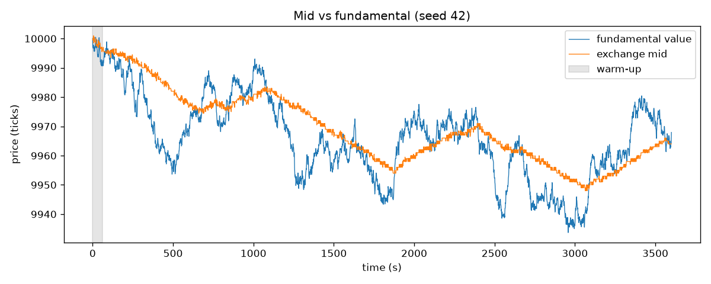

# Module 9: The traders

> **In one sentence:** most of lobsim's market is made of "zero-intelligence" traders who place random orders around the price they see, plus one trader who secretly knows what the stock is really worth.
>
> **You will be able to:** state the rules of the noise traders and the informed trader, read their code, explain the hidden fundamental value as a random walk, explain the reference-price bias that lobsim found and fixed, use Little's law to predict the size of the book, and write your own trader.
>
> **Time:** about 4 hours.

## 9.1 Zero intelligence: a market of random traders

In 1993 the economists Gode and Sunder ran a classroom-style market with computer traders that bid **at random**, limited only by a budget, and found that the market still allocated goods almost perfectly efficiently. Later, Smith, Farmer and others modelled real order books as random streams of limit orders, market orders and cancellations, and found that such "zero-intelligence" (ZI) models explain a surprising amount of how real books behave.

ZI traders have no strategy and no memory. They are not a claim about how people think. They are a **baseline**: "this is what a market looks like when nobody is trying to be clever". If a result appears with only ZI traders, it comes from the mechanics of the order book, not from anyone's intelligence. lobsim's background market is ten ZI **noise traders** (SPEC.md 5.6, after Smith, Farmer et al.).

## 9.2 The noise trader's rules

Default settings (`configs/default.json`, section `noise_traders`):

| Setting | Value | Meaning |
|---|---|---|
| `count` | 10 | ten independent traders |
| `lambda` | 5.0 | each wakes as a Poisson process, 5 times a second on average |
| `p_limit` | 0.85 | 85% of wakeups send a limit order, 15% a market order |
| side | 50/50 | buy or sell, like a coin flip |
| `D` | 10 | a limit order goes `d` ticks away from the reference price, `d` uniform from 1 to 10 |
| `max_size` | 10 | size uniform from 1 to 10 lots |
| `order_lifetime_mean_s` | 30.0 | every resting limit order is cancelled after an exponential lifetime with mean 30 s, unless it fills first |
| `reference_price` | `"symmetric"` | how the reference price is rounded (9.4) |
| latency | 200 µs ± 50 | slow, compared with the market maker |

The **reference price** is the trader's view of the market: the mid of the last BBO it received, rounded to a whole tick; if it has no two-sided BBO, the last trade price it heard about; if it has heard nothing, the initial price (10,000). A buy limit goes at `reference − d`, a sell at `reference + d`. Because the trader's view is late, a limit order can occasionally cross the real book and trade on arrival. SPEC.md says plainly: "That is expected."

## 9.3 Read the real code: `src/sim/noise_trader.cpp`

The header `include/sim/agents/noise_trader.hpp` lists its random draws in a fixed order. That list is a promise: changing the order of draws changes every run.

```
//   on_start:  one exponential (time to the first trading wakeup), from ctx.rng().
//   trading wakeup, all from ctx.rng():
//     1. limit or market   uniform01() < p_limit
//     2. side              uniform_int(0, 1): 0 = buy, 1 = sell
//     3. limit only: d     uniform_int(1, D)
//     4. size              uniform_int(1, max_size)
//     5. time to the next trading wakeup: exponential(lambda)
//   Ack of a limit order: one exponential (the order's lifetime) from the trader's own
//     lifetime stream, never from ctx.rng() (see Context::rng()).
```

The trading decision, line 42:

```cpp
void NoiseTrader::trade(Context& ctx) {
  Xoshiro256StarStar& rng = ctx.rng();
  const bool is_limit = rng.uniform01() < p_.p_limit;
  const lob::Side side = rng.uniform_int(0, 1) == 0 ? lob::Side::Buy : lob::Side::Sell;
  const lob::Price d = is_limit ? rng.uniform_int(1, p_.D) : 0;
  const lob::Qty size = rng.uniform_int(1, p_.max_size);
  const double next_s = rng.exponential(p_.lambda);
  timers_.schedule(ctx, ctx.now() + seconds_to_ns(next_s), TradeTimer{});

  const std::uint64_t client_id = next_client_id_++;
  if (!is_limit) {
    ctx.send(lob::NewOrder{ctx.self(), client_id, side, lob::OrderType::Market, lob::TIF::IOC, 0, size, false,
                           lob::STP::CancelTaking});
    ++markets_sent_;
    return;
  }
  const lob::Price price = std::clamp<lob::Price>(
      side == lob::Side::Buy ? buy_reference_price() - d : reference_price() + d, 1, p_.max_price);
  awaiting_ack_[client_id] = size;
  ctx.send(lob::NewOrder{ctx.self(), client_id, side, lob::OrderType::Limit, lob::TIF::GTC, price, size, false,
                         lob::STP::CancelTaking});
  ++limits_sent_;
}
```

Every draw happens in the documented order, each on its own line (never two draws inside one function call: Module 7). The next wakeup is scheduled before the order is even sent. `std::clamp(x, 1, max_price)` keeps the price legal.

The wakeup handler, line 15, uses a `TimerQueue` (Module 8) because there are two kinds of alarm:

```cpp
void NoiseTrader::on_wakeup(Context& ctx) {
  const Timer timer = timers_.pop_due(ctx.now());
  if (std::holds_alternative<TradeTimer>(timer)) {
    trade(ctx);
    return;
  }
  // Cancel timer: the order's lifetime is over. Send the cancel only if the order is
  // still open by this trader's own records; if a fill is in flight the exchange answers
  // UnknownOrder, which on_private() ignores.
  const lob::OrderId id = std::get<CancelTimer>(timer).order_id;
  if (open_.find(id) == open_.end()) return;
  ctx.send(lob::Cancel{ctx.self(), id});
  ++cancels_sent_;
}
```

Private messages (line 78) keep the trader's **own records**: which limit orders are waiting for an `Ack` (`awaiting_ack_`, by client id), and which are resting and how much is left (`open_`, by order id). On an `Ack` of a limit order it draws the order's lifetime from its separate lifetime stream and sets a cancel alarm; on a `Trade` it reduces the order; on `Cancelled` it forgets it; a `Reject` is counted and ignored (usually `UnknownOrder`: the order filled while the cancel was travelling).

`on_market_data` (line 66) stores the latest BBO, or the last trade price if the message was a `TradePrint`.

**Skipped on purpose:** the `on_private` of `CalibratedFlowAgent` (Module 14) is almost the same bookkeeping; read this one and you have read both.

## 9.4 A rounding bias that moved the market

SPEC.md's original rule was: buy at `floor(mid) − d`, sell at `floor(mid) + d`. Look at what happens when the spread is odd, say bid 100 and ask 103 (mid 101.5, floor 101):

- a buy goes at 101 − d, so at **100 or lower**: at best it *joins* the best bid;
- a sell goes at 101 + d, so at **102 or higher**: with d = 1 it *improves* the best ask from 103 to 102.

Sells can move the ask down, buys can never move the bid up. Over an hour the price drifts **down** for no reason at all. lobsim's author measured it: over 12 seeds of a noise-only hour, the price fell 91 to 117 ticks, more than the 60-tick standard deviation of the fundamental value it is supposed to follow (DECISIONS.md D-089, README table).

The fix, `"reference_price": "symmetric"`: buys measure from `ceil(mid)` (102 here, so a buy at 102 − 1 = 101 improves the bid) and sells from `floor(mid)`. With an even spread both are the same and nothing changes. The default config uses the symmetric rule; the spec's rule stays available as `"floor"` and is still the default when the key is missing, so the spec's own JSON keeps meaning exactly what it said (D-090).

```cpp
lob::Price NoiseTrader::reference_price() const {
  if (bbo_.two_sided()) return (bbo_.bid + bbo_.ask) / 2;  // integer division: floor for positive prices
  if (last_trade_) return *last_trade_;
  return p_.initial_price;
}

lob::Price NoiseTrader::buy_reference_price() const {
  if (p_.reference_price == ReferencePrice::Symmetric && bbo_.two_sided()) return (bbo_.bid + bbo_.ask + 1) / 2;
  return reference_price();
}
```

`(bid + ask) / 2` with whole numbers drops the half: that is `floor`. `(bid + ask + 1) / 2` rounds the half up: `ceil`. This is a good example of how lobsim treats its own spec: when measurement showed a rule was biased, the change was made, measured, documented, and kept optional.

## 9.5 The hidden true value

Real stocks have a "fundamental value", what the company is really worth given everything knowable. Nobody sees it directly. lobsim models it as a **random walk** (`include/sim/fundamental.hpp`, SPEC.md 5.5):

```cpp
  Fundamental(double initial, double sigma_ticks_per_sqrt_s, double dt_s, Xoshiro256StarStar rng) noexcept
      : value_(initial), step_sd_(sigma_ticks_per_sqrt_s * std::sqrt(dt_s)), rng_(rng) {}

  void step() noexcept {
    value_ += step_sd_ * rng_.normal();
    ++steps_;
  }
```

Every `dt = 0.1` s, the value moves by a normal random step with standard deviation σ √dt = 1 × √0.1 ≈ 0.316 ticks. Random-walk steps add up so that the **spread of possible values grows with the square root of time**: after t seconds the standard deviation is σ √t. After one hour, √3600 = 60 ticks. That is what "σ = 1 tick per square-root second" means. The walk has no drift: it is as likely to go up as down.

Only the informed trader reads it. The market's mid follows it only if somebody pushes the price there.

## 9.6 The informed trader

`src/sim/informed_trader.cpp`, the whole decision:

```cpp
void InformedTrader::on_wakeup(Context& ctx) {
  // Draw and schedule first: the wakeup schedule must not depend on the market.
  ctx.schedule_wakeup(ctx.now() + seconds_to_ns(ctx.rng().exponential(p_.lambda)));

  const double v = fundamental_.value();
  lob::Side side;
  if (bbo_.has_ask() && v - static_cast<double>(bbo_.ask) >= p_.theta_ticks) side = lob::Side::Buy;
  else if (bbo_.has_bid() && static_cast<double>(bbo_.bid) - v >= p_.theta_ticks) side = lob::Side::Sell;
  else return;

  ctx.send(lob::NewOrder{ctx.self(), next_client_id_++, side, lob::OrderType::Market, lob::TIF::IOC, 0, p_.size,
                         false, lob::STP::CancelTaking});
  ...
}
```

Twice a second on average (λ = 2), it compares the true value `v` with the (late) BBO it last received. If the stock is worth at least θ = 2 ticks **more** than the ask, it buys 5 lots at market; if it is worth at least 2 ticks **less** than the bid, it sells. Otherwise it does nothing. It has no position limit and never tries to unwind. It is the market's source of **adverse selection**: whoever sells to it is selling something worth more than they are paid. Module 10 and 11 measure what that does to the market maker.

## 9.7 What the market looks like



(From `docs/sample_run/`, the default run, seed 42.) The orange mid follows the blue fundamental only loosely and late. The README measures the gap after the warm-up: 8.5 ticks on average, 10 ticks or more 34% of the time, up to 28 ticks. Why so loose? Noise traders place orders around the **mid they see**, so they hold the price where it is. Only the informed trader's 5-lot market orders pull it toward the fundamental, and only when the gap is at least 2 ticks.

**Little's law.** How many orders rest in the book? A rule from queueing theory says: average number in the system = arrival rate × average time in the system (L = λW). Noise traders send about 10 × 5 × 0.85 = 42.5 limit orders a second, and each lives at most 30 s on average (less if it fills first), so the book should hold somewhat fewer than 42.5 × 30 ≈ 1,275 orders. The default run ended with 1,135 resting orders.

## Lab 9.1: check the rules against what happened

```sh
python3 course/labs/py/who_traded.py out/run1
```

The first part counts the noise traders' new orders in `orders.log`. When this course was written:

```
noise traders sent 179318 new orders
  limit 0.849, market 0.151   (rule: 0.85 / 0.15)
  buy 0.500, sell 0.500     (rule: 0.5 / 0.5)
  size shares: 1:0.099 2:0.098 3:0.102 4:0.100 5:0.100 6:0.102 7:0.101 8:0.100 9:0.099 10:0.100   (rule: 0.1 each)
```

The second part gives every role's profit or loss, marked at the last mid:

```
marked at the last mid 9964.0 (fees left out):
  informed      bought   10205 sold   18140 lots, ends with -7935, PnL   +92488.0 ticks (+3.263 per lot)
  market maker  bought   13565 sold   13599 lots, ends with   -34, PnL   +12232.0 ticks (+0.450 per lot)
  noise         bought  135212 sold  127243 lots, ends with +7969, PnL  -104720.0 ticks (-0.399 per lot)
```

1. Add up the three PnL numbers. What do you get, and why must it be that?
2. The informed trader ends **short** almost 8,000 lots. Looking at the plot in 9.7, why did it keep selling?
3. Is the informed trader's profit all "skill"? What would happen to its PnL if the price had jumped up at the very end?

<details><summary>Answers</summary>

1. 92,488 + 12,232 − 104,720 = 0. Every trade has a buyer and a seller: whatever one gains in cash, the other pays, and every share one ends long, someone ends short. Marked at the same price, the total is exactly zero (before fees). Trading is a zero-sum game: the noise traders' losses are the others' gains.
2. The fundamental spent most of the hour well below the mid, so the bid was often 2 or more ticks above the true value and the rule said "sell". The price followed down only slowly, so the gap kept reopening.
3. No. Part of it is information (it sold things worth less than it was paid), and part is just a huge open position marked at the last mid. If the mid had jumped up at the end, the short position would have lost a lot. Lab 11 measures the information part more carefully with markouts. (With seed 7 the same script shows the informed trader ending short 13,110 lots.)

</details>

## Lab 9.2: the rounding bias, measured

The lab folder has two noise-only configs (no informed trader, no market maker) that differ only in `reference_price`:

```sh
for rule in floor symmetric; do
  for seed in 1 2 3; do
    build/release/lobsim_run --config course/labs/configs/noise_only_$rule.json --seed $seed --out out/noise_${rule}_$seed > /dev/null
    echo "$rule seed $seed final mid: $(tail -1 out/noise_${rule}_$seed/bbo.csv | cut -d, -f6)"
  done
done
```

Predict first: the start price is 10,000. When this course was written:

```
floor seed 1 final mid: 9909.0
floor seed 2 final mid: 9883.5
floor seed 3 final mid: 9889.0
symmetric seed 1 final mid: 10013.0
symmetric seed 2 final mid: 9991.0
symmetric seed 3 final mid: 9993.0
```

The floor rule loses 91 to 117 ticks every time; the symmetric rule wanders a few ticks either way. With no fundamental value to follow (no informed trader), there is no reason for the price to fall, so the drift is pure rounding.

## Lab 9.3: change the crowd

Copy `configs/default.json` to a file of your own and change one noise-trader setting at a time. Run each for the full hour and compare the summaries (`spread.mean_ticks`, the market maker's `pnl_after_warmup`, `returns.sd`) and the `resting orders` line printed by `lobsim_run`. Predict before each run. When this course was written:

| Change | Mean spread | Resting at the end | MM lots traded | MM PnL | Std of 1 s returns |
|---|---|---|---|---|---|
| none (default) | 1.94 | 1,135 | 26,670 | 12,263 | 6.43e-05 |
| `D` 10 → 3 | 1.00 | 1,055 | 0 | 0 | 0 |
| `D` 10 → 30 | 1.92 | 1,163 | 55,067 | 1,963 | 1.80e-04 |
| lifetime 30 s → 5 s | 1.91 | 200 | 37,771 | 15,659 | 9.00e-05 |
| lifetime 30 s → 120 s | 1.95 | 4,314 | 22,165 | 10,095 | 5.62e-05 |

Explain:

1. Use Little's law to check the "resting" column for the two lifetime rows.
2. With `D = 3` the price **never moved** in the whole hour (the bid stayed at 9999 and the ask at 10000) and the market maker never traded after the warm-up. Why? (Hint: `head -1000 out/<your run>/bbo.csv | tail -3` shows the sizes at the best bid and ask.)
3. With `D = 30` the market maker traded twice as much but earned far less. Why?

<details><summary>Answers</summary>

1. 42.5 orders/s × 5 s ≈ 212 (measured 200); × 120 s = 5,100 (measured 4,314). Fills remove some orders before their lifetime ends, so the measured numbers are a bit lower.
2. All limit orders land within 1 to 3 ticks of the mid, so hundreds of lots pile up at the best bid and ask (several hundred each in the run). Market orders are at most 10 lots (the informed trader's 5), so they can never use up the best level, and new limit orders keep refilling it. The spread stays at 1 tick, the mid at 9999.5, and every return is 0. The market maker quotes one tick behind the best on each side (its formula wants a total spread of about 1.7 ticks, rounded outwards), so it sits behind hundreds of lots and never gets filled.
3. With orders spread over 30 ticks, little liquidity sits near the mid. The market maker's quotes are more often the best prices, so it trades more (its share of all traded lots as maker went from 17% to 36% in these runs), but each market order also moves the price further (returns are almost 3 times as volatile). Within 30 s of its fills the mid moved against it by 0.83 ticks per lot on average, against 0.44 in the default run, which eats most of the roughly 1 tick it earns per lot. Module 11 explains these "markout" numbers.

</details>

## Lab 9.4: write your own trader

```sh
course/labs/build_lab.sh course/labs/lab09_my_agent.cpp
build/release/labs/lab09_my_agent
```

`lab09_my_agent.cpp` adds one new agent, "Copycat", to a ten-minute default run with `Simulator::add_agent`. Once a second it compares the last trade price it heard about with the one from a second earlier, and buys 1 lot at market if the price rose, sells 1 lot if it fell (never holding more than 20 lots either way). Read the whole file first: it is a complete example of the agent interface from Module 8 (`on_start`, `on_wakeup`, `on_market_data`, `on_private`, `ctx.send`, `ctx.schedule_wakeup`, `ctx.self`).

When this course was written:

```
Copycat is agent 12 (owner id 13)
orders sent 378, fills 378, final inventory -8 lots
cash 79483 ticks, last mid 9979.0
PnL = cash + inventory * mid = -349.0 ticks
```

Now improve it. Some ideas, from easy to hard:

1. Reverse the rule (buy after a fall, sell after a rise). When this course was written that lost 453 ticks.
2. Trade only when the spread is 1 tick (you have `bbo_`).
3. Use limit orders at your side's best price instead of market orders, so you are paid the spread instead of paying it. You will need to track your resting orders (look at how `NoiseTrader` does it) and cancel them after a while.
4. Make your trader look at the size at the best bid versus the best ask before deciding ("order book imbalance").

Questions: why do both Copycat and its reverse lose money? And why is the "last mid" of this run different from a run without Copycat?

<details><summary>Answers</summary>

Every market order buys at the ask or sells at the bid, so each 1-lot trade costs about half the spread (about 1 tick here) compared with the mid. Copycat made 378 trades: that is roughly 378 ticks of cost, close to its loss. Its signal (the last trade price) mostly reflects the bid-ask bounce, which says nothing about where the price goes next, so it cannot win back what it pays. And the run differs because Copycat's orders trade with other agents' orders and change the book they all see: the other agents make the same decisions (Module 7), but at different prices.

</details>

## Common questions

**Are the noise traders "stupid"?** They are deliberately simple, so their effect can be understood. Real markets have many uninformed traders too (people investing savings, funds rebalancing), who trade for reasons unrelated to short-term price moves.

**Why does the informed trader not get even richer by trading bigger?** It does trade more with `size` 20 or `lambda` 10 (README variants), but bigger market orders eat deeper into the book and pay worse prices. It also has no idea how far the price will follow.

**Why is the fundamental a random walk with no drift?** It is the simplest model with the right "you cannot predict the next step" property. The README lists "a fundamental value that is a driftless random walk with constant volatility" among the things lobsim does not model in a richer way.

**Why do noise traders cancel after an exponential lifetime?** It gives every resting order a constant chance of being cancelled per second, so the book settles at a steady size instead of growing forever (SPEC.md 5.6). Real lifetimes are not exponential, which Module 14's calibration measures.

**What does `seconds_to_ns` do?** Converts a random duration in seconds to whole nanoseconds, at least 1 ns (so time always moves forward) and at most `kFarFutureNs` (so adding it to the clock can never overflow).

## Quiz

1. List the five random draws of a noise trader's trading wakeup, in order.
2. A noise trader's last BBO is bid 200, ask 203. With the symmetric rule and d = 1, where do its buy and sell limits go? And with the floor rule?
3. After 100 s, what is the standard deviation of the fundamental's change? After 400 s?
4. The informed trader's last BBO is bid 9990, ask 9992, and V = 9994.5. What does it do? And if V = 9993.5?
5. Use Little's law: 20 limit orders per second, mean lifetime 10 s, few fills. About how many rest in the book?
6. Why does the sum of all traders' PnL come to zero?

<details><summary>Answers</summary>

1. Limit or market (`uniform01() < p_limit`); side; `d` (limit orders only); size; time to the next wakeup.
2. Symmetric: buy at ceil(201.5) − 1 = 201 (improving the bid), sell at floor(201.5) + 1 = 202 (improving the ask). Floor: buy at 201 − 1 = 200 (joins the bid), sell at 202.
3. σ √t: √100 = 10 ticks; √400 = 20 ticks.
4. V − ask = 2.5 ≥ 2: market buy of 5 lots. With V = 9993.5, V − ask = 1.5 and bid − V is negative: it does nothing.
5. About 20 × 10 = 200.
6. Every trade moves cash from the buyer to the seller and shares from the seller to the buyer. Summed over everyone, cash changes cancel and positions cancel, so with every position marked at the same price the total is 0 (fees aside).

</details>

## What's next

Module 10 meets the most interesting trader: the market maker, who stands in the middle, quotes both sides all the time, and has to survive both the inventory it piles up and the informed trader.
